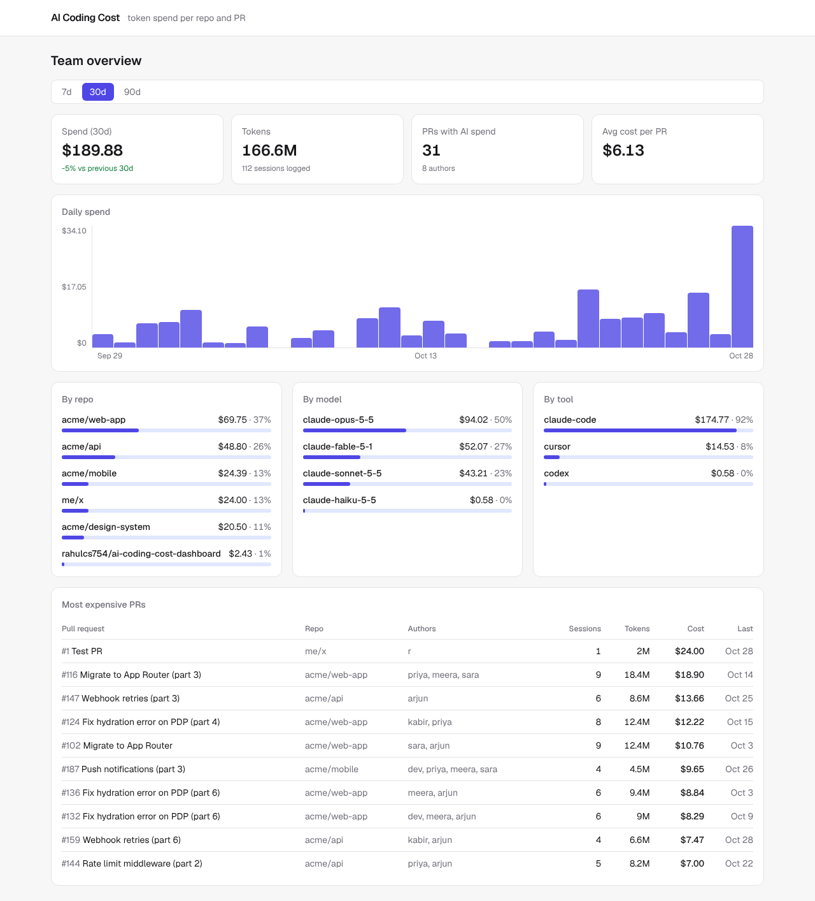

# AI Coding Cost Dashboard

See how much your team spends on AI coding agents (Claude Code, Cursor, Codex), per repo, per PR, per author and per model.

Built with Next.js 16 (App Router, Cache Components), TypeScript, Tailwind v4 and SQLite (`node:sqlite`).



## Run it

Needs Node 22.13 or newer.

```bash
npm install
npm run dev
```

Open http://localhost:3000. On first start the database (`data/usage.db`) is filled with 90 days of demo data. Set `SEED_DEMO=false` to start empty.

## Send usage

`POST /api/events` takes one event, an array, or `{ "events": [...] }`. Set `INGEST_TOKEN` and send it as a bearer token (in development the endpoint is open when no token is set).

```bash
curl -X POST http://localhost:3000/api/events \
  -H "authorization: Bearer $INGEST_TOKEN" -H "content-type: application/json" \
  -d '{"repo":"acme/web-app","pr":42,"author":"priya","tool":"claude-code","model":"claude-opus-5-5","inputTokens":120000,"outputTokens":8000}'
```

Cost is computed at ingest from `src/lib/pricing.ts` and stored.

### From Claude Code logs

`scripts/report-usage.mjs` reads `~/.claude/projects/**/*.jsonl`, sums usage per session and model, finds the GitHub repo from `git remote` and the PR from `gh`, and uploads. It remembers the last run, so you can put it in a cron job.

```bash
INGEST_TOKEN=... node scripts/report-usage.mjs --url http://localhost:3000 --since 7d
node scripts/report-usage.mjs --dry-run   # print, don't upload
```

## Login and team

Login is optional. Without GitHub OAuth settings the dashboard runs open in demo mode.

To turn it on:

1. Create a GitHub OAuth App (GitHub → Settings → Developer settings → OAuth Apps). Set the callback URL to `https://<your-domain>/api/auth/callback/github`.
2. Set `AUTH_GITHUB_ID`, `AUTH_GITHUB_SECRET`, `AUTH_SECRET` (run `npx auth secret`) and `ADMIN_GITHUB_LOGINS`.
3. Admins invite people on the **Team** page as `member` or `admin`. Only invited GitHub accounts can sign in, and removing someone blocks them on their next request.

`POST /api/events` stays outside login and uses `INGEST_TOKEN` instead.

## Environment

| Variable | Purpose |
| --- | --- |
| `INGEST_TOKEN` | Bearer token for `POST /api/events` (required in production) |
| `DATABASE_PATH` | SQLite file path (default `data/usage.db`, `/tmp/usage.db` on Vercel) |
| `SEED_DEMO` | `false` to skip demo data |
| `AUTH_GITHUB_ID`, `AUTH_GITHUB_SECRET` | GitHub OAuth App credentials. Leave unset for demo mode |
| `AUTH_SECRET` | Secret for signing sessions (`npx auth secret`) |
| `ADMIN_GITHUB_LOGINS` | Comma-separated GitHub usernames that are always admins |

## Docs

- [docs/PROJECT-INSTRUCTIONS.md](docs/PROJECT-INSTRUCTIONS.md)
- [docs/MVP-PLAN.md](docs/MVP-PLAN.md)
